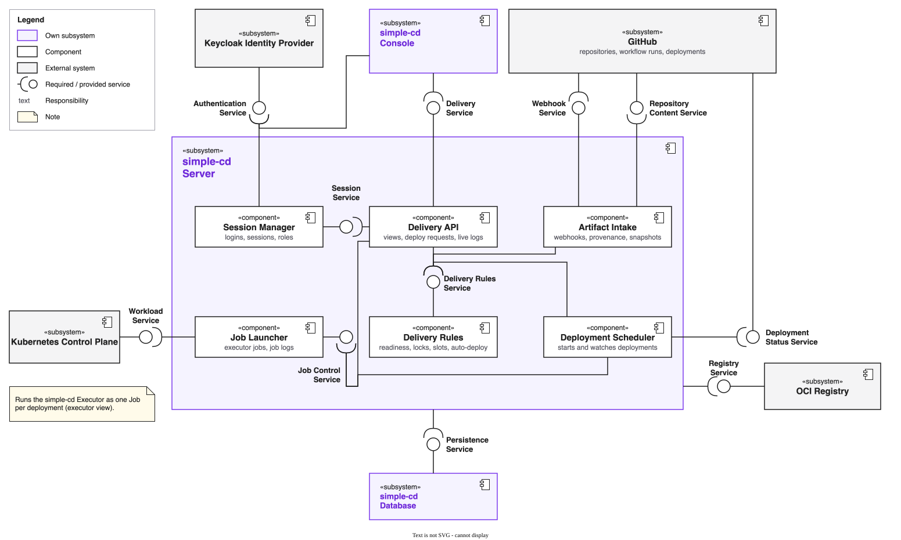

# simple-cd

simple-cd is a small continuous delivery server.
It builds nothing and runs no tests: your GitHub Actions workflows do that.
simple-cd sees the artifacts they publish, checks that they are complete, and lets authorized people deploy them to Helm, Docker Compose and Ansible targets with one click.

**Documentation: <https://mtze.me/simple-cd/>**

## Features

- Helm releases from OCI charts, a single Docker Compose file on a VM, or Ansible playbooks
- Images pinned by digest, provenance taken from GitHub, forks rejected
- Readiness per artifact and target, with the reasons when something is missing
- Confirmation diff when the Helm values or the Compose file change
- Opt-in locks per target, maintenance mode, one deployment per slot
- Preview namespaces per pull request with a TTL and automatic teardown
- Auto-deploy on request of the workflow and with a rule on the target
- Live logs over Server-Sent Events, deployments mirrored to GitHub
- Keycloak roles per project (developer, maintainer), per target and for platform admins
- Secrets read from Vault by the executor Job, never by the server
- Audit log, retention, leader-elected background worker, stateless replicas

## How it works



A workflow builds images and a chart and runs the [`cd-publish`](cd-publish/action.yml) action, which uploads `deploy.json` with the image digests.
The simple-cd GitHub App receives the `workflow_run` webhook, reads `deploy.json` and `.cd.yaml` at the commit and stores the artifact.
A deploy starts a Kubernetes Job that logs in to Vault and runs `helm`, `docker compose` over SSH, or `ansible-playbook`.

```yaml
# .github/workflows/build.yml (excerpt)
- uses: Mtze/simple-cd/cd-publish@main
  with:
    images: |
      server=ghcr.io/example/app-server@${{ steps.server.outputs.digest }}
    helm-version: ${{ steps.chart.outputs.version }}
```

## Quick start (development)

Needs Go, Node.js 26 and Docker.

```sh
make dev-up     # Postgres and Keycloak on 127.0.0.1
make dev-seed   # demo data
make web        # build the UI
make run        # server on http://127.0.0.1:8080
```

Log in as `alice`, `bob`, `mia`, `root` or `guest`, password `dev`.
Details in [Local development](https://mtze.me/simple-cd/contributors/development.html).

## Documentation

| For | Start here |
|---|---|
| Developers who deploy | [Getting started](https://mtze.me/simple-cd/users/getting-started.html) |
| Project maintainers | [Maintainers](https://mtze.me/simple-cd/maintainers/) |
| Platform operators | [Administrators](https://mtze.me/simple-cd/admin/) |
| Contributors | [Contributors](https://mtze.me/simple-cd/contributors/), [CONTRIBUTING.md](CONTRIBUTING.md) |
| File formats, API, settings | [Reference](https://mtze.me/simple-cd/reference/) |
| Design | [Architecture](https://mtze.me/simple-cd/architecture/) |

Security issues: see [SECURITY.md](SECURITY.md).
Changes: see [CHANGELOG.md](CHANGELOG.md).

## License

[MIT](LICENSE)
