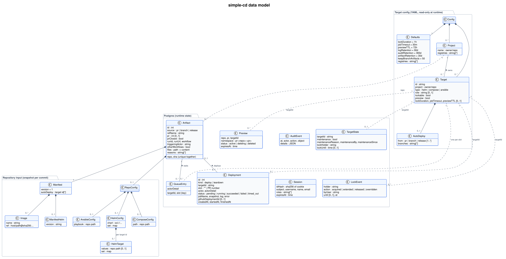

# Data model

The model has three parts.

**Target configuration** (top right).
`Config` holds the `Defaults`, the `Project`s and the `Target`s.
It is read from YAML and never changed by the server.
A project owns its targets through the `project` field; a target may carry an `AutoDeploy` rule.
Projects without an entry under `projects` exist implicitly through their targets.

**Repository input** (bottom left).
Each artifact embeds the parsed `deploy.json` (`Manifest` with its `Image`s and optional `ManifestHelm` version) and the parsed `.cd.yaml` (`RepoConfig` with optional `HelmConfig`, `ComposeConfig` and `AnsibleConfig`).
`HelmConfig` keeps a `HelmTarget` per target id for target-specific values files and `set` entries.
Together with the `files` map (path to content) this snapshot makes an artifact independent of later changes in the repository.

**Runtime state in Postgres** (middle).

| Class | Table | Notes |
|---|---|---|
| `Artifact` | `artifacts` | one per repository and commit; a newer workflow run replaces an older one |
| `Deployment` | `deployments` | a deploy or a preview teardown; a unique index allows one pending or running deployment per target and slot. The artifact link becomes empty when retention deletes the artifact. |
| `QueueEntry` | `deploy_queue` | the waiting place of auto-deploys, one per target and slot, the newest wins |
| `TargetState` | `target_state` | maintenance and lock of a target, created on first use. Every decision about a target locks this row. |
| `LockEvent` | `lock_history` | acquire, extend, release and takeover of locks |
| `Preview` | `previews` | one live preview per target and pull request (`active` or `deleting`), plus deleted ones as history |
| `AuditEvent` | `audit_events` | who did what, with JSON details |
| `Session` | `sessions` | login sessions, keyed by the SHA-256 of the cookie value |

The links between runtime state and targets (dashed) are plain target ids, not foreign keys: the configuration lives in a file, and history survives when a target is removed.
Not shown: `auth_requests` (pending logins, valid for 10 minutes) and `schema_migrations`.
