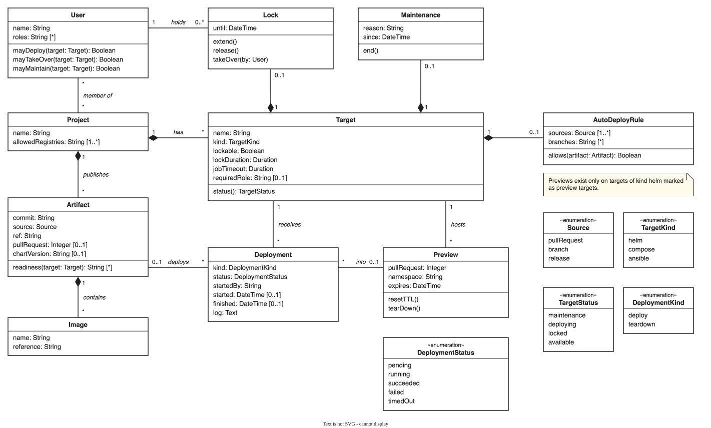

# Object model
{: .no_toc }

1. TOC
{:toc}

## Application domain

A **Project** is one GitHub repository; its members are **Users** with a project role (developer or maintainer).
The project publishes **Artifacts**: one per commit, with its **Images** pinned by digest and an optional chart version.
`Artifact.readiness(target)` lists why the artifact cannot go to a target; an empty list means it can.

A **Target** belongs to exactly one project and has a kind (helm, compose or ansible).
At any time it may have one **Lock** held by a User and one **Maintenance**; `Target.status()` combines them with running deployments into a single status (see [state machines](states.md)).
An **AutoDeployRule** says which sources may deploy without a click.

A **Deployment** brings an artifact to a target, or tears a **Preview** down.
Preview targets host one preview per pull request; a deployment into a preview resets its TTL.

## How it is stored

The target configuration (projects, targets, auto-deploy rules) lives in a YAML file and never changes at runtime.
Each artifact embeds the parsed `deploy.json` and `.cd.yaml` and a snapshot of the files they name, so it stays deployable when the repository changes later.
Everything else is runtime state in Postgres:

| Class | Table | Notes |
|---|---|---|
| `Artifact` | `artifacts` | one per repository and commit; a newer workflow run replaces an older one |
| `Deployment` | `deployments` | a deploy or a preview teardown; a unique index allows one pending or running deployment per target and slot. The artifact link becomes empty when retention deletes the artifact. |
| `QueueEntry` | `deploy_queue` | the waiting place of auto-deploys, one per target and slot, the newest wins |
| `TargetState` | `target_state` | maintenance and lock of a target, created on first use. Every decision about a target locks this row. |
| `LockEvent` | `lock_history` | acquire, extend, release and takeover of locks |
| `Preview` | `previews` | one live preview per target and pull request (`active` or `deleting`), plus deleted ones as history |
| `AuditEvent` | `audit_events` | who did what, with JSON details |
| `Session` | `sessions` | login sessions, keyed by the SHA-256 of the cookie value |

The links between runtime state and targets are plain target ids, not foreign keys: the configuration lives in a file, and history survives when a target is removed.
Not shown: `schema_migrations`. Pending logins are not stored; they live in a short-lived cookie.
