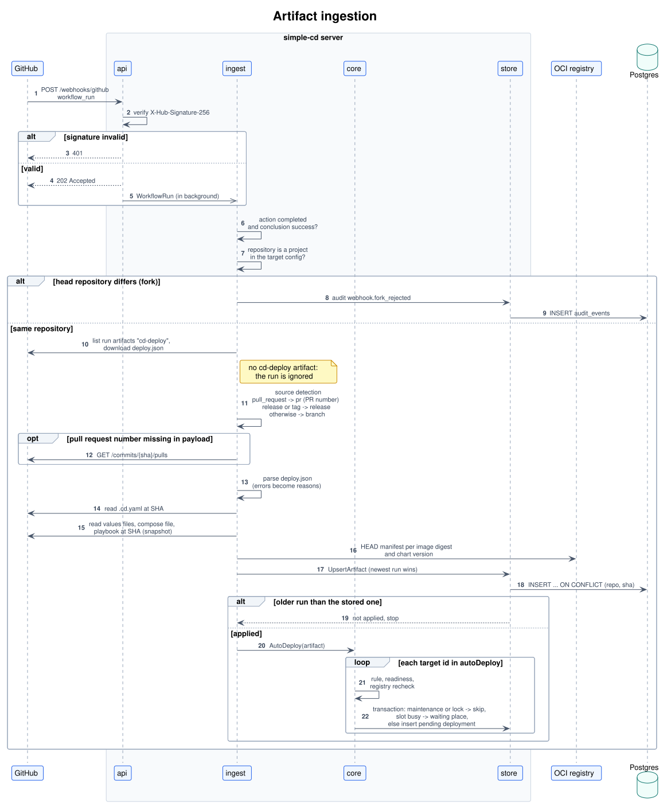
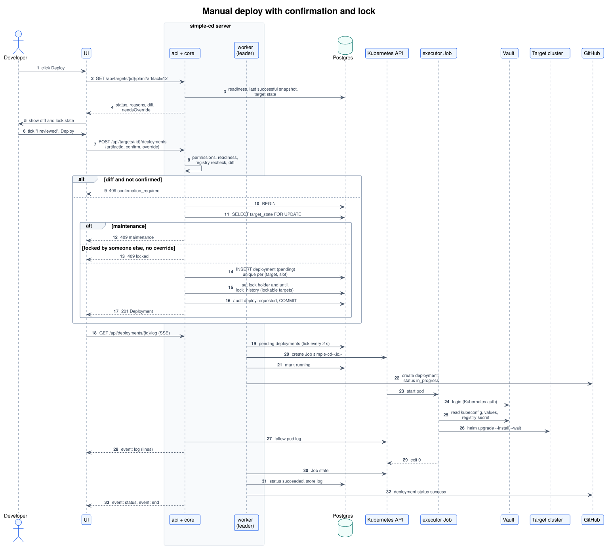
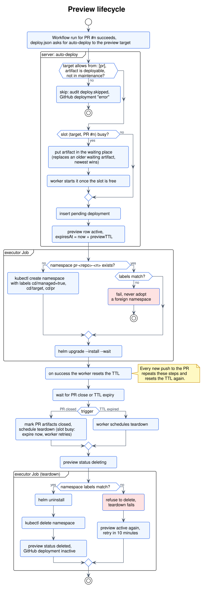

# Flows
{: .no_toc }

1. TOC
{:toc}

## Artifact ingestion

GitHub sends a `workflow_run` webhook when a run completes.
The api component checks the HMAC signature, answers `202` at once and hands the event to ingest in the background.
Ingest ignores runs that did not succeed, repositories that are not projects, and runs from forks (recorded as `webhook.fork_rejected`).
It downloads `deploy.json` from the run's `cd-deploy` artifact; runs without that artifact are ignored.
The source comes from GitHub: `pull_request` runs are `pr` (the PR number from the payload, or from the commit's open pull requests), `release` runs and tag pushes are `release`, everything else is `branch`.
Ingest then reads `.cd.yaml` and the files it names at the commit, checks every image digest and the chart version in the registry, and stores the artifact.
Parse errors and missing images become reasons on the artifact instead of dropping it.
When the stored run is newer than the incoming one, nothing changes; otherwise core starts the requested auto-deploys.

## Manual deploy with confirmation and lock

The deploy dialog first asks for a plan, which computes readiness, the diff against the last successful deployment and the lock situation without changing anything.
On **Deploy**, core checks permissions, readiness, the registry and the diff again.
If the configuration changed and the user has not confirmed, it answers `409 confirmation_required` with the diff.
Then one transaction locks the target's state row (`SELECT ... FOR UPDATE`), rejects maintenance and foreign locks, inserts the pending deployment (the unique index on target and slot rejects a busy slot) and takes or extends the lock.
The worker on the leader replica picks the pending row up within two seconds, creates the Job, marks the deployment running and creates a GitHub deployment.
The executor logs in to Vault, reads the kubeconfig and values and runs Helm.
Meanwhile the api component follows the pod log and streams it to the browser as Server-Sent Events.
When the Job ends, the worker stores the status and the log and sets the GitHub deployment status.

## Preview lifecycle

A preview starts with an auto-deploy (or a click) for a pull request artifact on a preview target.
The slot is the pair of target and pull request; if it is busy, the artifact waits, and a newer push replaces a waiting one.
Each deploy marks the preview active and sets its expiry to now plus `previewTTL`; a successful deploy resets it again.
The executor creates the namespace `pr-<repo>-<pr>` with the labels `cd/managed`, `cd/target` and `cd/pr`, and refuses to use an existing namespace without them.
When the pull request closes, simple-cd hides its artifacts and schedules the teardown; if a deployment still runs in the slot, it expires the preview so the worker retries.
When the TTL runs out, the worker schedules the teardown itself.
The teardown checks the labels again, removes the release and the namespace, and marks the GitHub deployment inactive.
A failed teardown sets the preview back to active with an expiry 10 minutes later, so it is retried.
