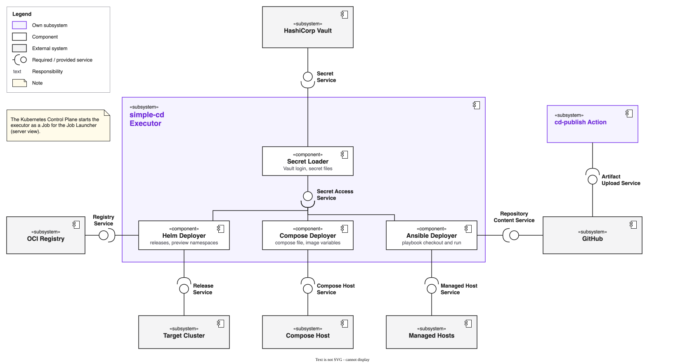
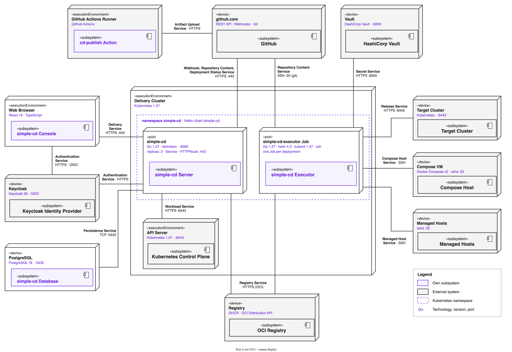

# Architecture
{: .no_toc }

This section describes simple-cd with UML diagrams.
The structural views (object model, components, deployment, service specifications) are hand-placed draw.io diagrams generated by [`docs/architecture/uml/diagrams.py`](https://github.com/Mtze/simple-cd/blob/main/docs/architecture/uml/diagrams.py).
The dynamic views (sequences, activities, state machines) are PlantUML files in [`docs/architecture/diagrams`](https://github.com/Mtze/simple-cd/tree/main/docs/architecture/diagrams).
The reasons behind the design are in the [design record](../design.md) (German) and the [architecture decisions](../adr/).

1. TOC
{:toc}

## Principles

- **Delivery only.** simple-cd never builds or tests. Workflows publish finished artifacts; simple-cd ships them.
- **Stateless servers, state in Postgres.** Any replica serves any request; one elected replica does the background work.
- **Configuration in Git, state in the database.** The target configuration says what a target is; Postgres says what state it is in.
- **Provenance from GitHub.** Repository, commit, source and pull request come from the GitHub App, never from files the workflow writes.
- **Secrets never pass through the server.** Each deployment runs in its own Kubernetes Job that reads its secrets from Vault itself.
- **Few dependencies.** Kubernetes, Vault, GitHub and registries are reached over plain HTTP.

## Components

simple-cd consists of five own subsystems: the **simple-cd Console** in the browser, the **simple-cd Server**, the **simple-cd Executor** that runs once per deployment, the **simple-cd Database** and the **cd-publish Action** that runs in the workflows of each project.
Two component diagrams show them: one for the server, one for the executor and the action.

### Server


### Executor and cd-publish



### Components and services

| Component | Provides | Uses |
|---|---|---|
| Delivery API | Delivery Service | Session Service, Delivery Rules Service, Job Control Service, Persistence Service (read-only views) |
| Session Manager | Session Service | Authentication Service, Persistence Service |
| Artifact Intake | Webhook Service | Delivery Rules Service, Repository Content Service, Registry Service, Persistence Service |
| Delivery Rules | Delivery Rules Service | Registry Service, Persistence Service |
| Deployment Scheduler | | Delivery Rules Service, Job Control Service, Deployment Status Service, Persistence Service |
| Job Launcher | Job Control Service | Workload Service |
| simple-cd Console | | Delivery Service, Authentication Service |
| simple-cd Database | Persistence Service | |
| Secret Loader | Secret Access Service | Secret Service |
| Helm Deployer | | Secret Access Service, Registry Service, Release Service |
| Compose Deployer | | Secret Access Service, Compose Host Service |
| Ansible Deployer | | Secret Access Service, Repository Content Service, Managed Host Service |
| cd-publish Action | | Artifact Upload Service |

External subsystems: **GitHub** provides the Webhook calls, Repository Content, Deployment Status and Artifact Upload Services; **Keycloak Identity Provider** the Authentication Service; **HashiCorp Vault** the Secret Service; **OCI Registry** the Registry Service; **Kubernetes Control Plane** the Workload Service; **Target Cluster**, **Compose Host** and **Managed Hosts** the Release, Compose Host and Managed Host Services.

Persistence and the Registry Service attach to the server border in the diagram because several components use them; the table lists the actual users.
In code the components map to packages: Delivery API `internal/api`, Session Manager `internal/auth`, Artifact Intake `internal/ingest` and `internal/github`, Delivery Rules `internal/core` and `internal/config`, Deployment Scheduler `internal/worker`, Job Launcher `internal/runner`, simple-cd Database `internal/store` with its migrations, the executor `internal/executor`.

### Rules the diagrams imply

- Only the Delivery Rules decide whether a deployment may start. The API, the intake and the scheduler ask them; none of them writes deployments, locks or previews directly.
- The Database belongs to the server. The executor never touches it; it only reports through its exit code and its log.
- The server never reads target secrets. The Secret Loader in each executor Job is the only reader of the Secret Service.
- Provenance (repository, commit, source, pull request) enters only through the Webhook and Repository Content Services, never through `deploy.json`.
- Each service has one provider. When a second component needs data another one owns, it uses that owner's service.

## Deployment



### Nodes

| Node | Runs | Notes |
|---|---|---|
| Web Browser | simple-cd Console | React 19, embedded in the server binary and served by it |
| Delivery Cluster, pod `simple-cd` | simple-cd Server | Go 1.27, distroless, `:8080`, 2 or more replicas behind a Service and an Ingress, service account `simple-cd` |
| Delivery Cluster, pod `simple-cd-executor` Job | simple-cd Executor | one Job per deployment in the same namespace, service account `simple-cd-executor` without Kubernetes permissions |
| Delivery Cluster, API Server | Kubernetes Control Plane | creates and watches the executor Jobs |
| PostgreSQL | simple-cd Database | PostgreSQL 18, operated outside the chart (managed service or an operator such as CloudNativePG) |
| Keycloak | Keycloak Identity Provider | confidential client with PKCE |
| Vault | HashiCorp Vault | Kubernetes auth method, KV v2 |
| github.com | GitHub | GitHub App with webhooks |
| GitHub Actions Runner | cd-publish Action | runs in each project's workflow |
| Registry | OCI Registry | GHCR or any OCI registry |
| Target Cluster, Compose VM, Managed Hosts | deployment targets | reached with credentials from Vault |

### Paths

| Path | Service | Protocol |
|---|---|---|
| Web Browser to `simple-cd` pod | Delivery Service | HTTPS :443 through the Ingress |
| Web Browser to Keycloak | Authentication Service | HTTPS, OIDC authorization code with PKCE |
| `simple-cd` pod to Keycloak | Authentication Service | HTTPS (discovery, token exchange, JWKS) |
| `simple-cd` pod to PostgreSQL | Persistence Service | TCP :5432 |
| `simple-cd` pod to API Server | Workload Service | HTTPS :6443 |
| github.com to `simple-cd` pod | Webhook Service | HTTPS :443, HMAC-SHA256 signed |
| `simple-cd` pod to github.com | Repository Content, Deployment Status Service | HTTPS :443, REST |
| `simple-cd` pod to Registry | Registry Service | HTTPS, OCI Distribution API |
| Runner to github.com | Artifact Upload Service | HTTPS |
| executor Job to Vault | Secret Service | HTTPS :8200 |
| executor Job to Registry | Registry Service | HTTPS, OCI (`helm pull`) |
| executor Job to github.com | Repository Content Service | SSH :22 (`git clone` of playbooks) |
| executor Job to Target Cluster | Release Service | HTTPS :6443 (`helm`, `kubectl`) |
| executor Job to Compose VM | Compose Host Service | SSH :22, host key checked |
| executor Job to Managed Hosts | Managed Host Service | SSH :22, host key checked |

Each pod mounts the target configuration from a ConfigMap and its own settings from a Secret.
The `simple-cd` service account may only manage Jobs and read pods and logs in its namespace.

## More diagrams

| Page | Diagrams |
|---|---|
| [Object model](data-model.md) | UML class diagram of the application domain, plus how it is stored |
| [Service specifications](services.md) | Delivery Service, Webhook Service and Delivery Rules Service as UML interfaces |
| [Flows](flows.md) | sequence diagrams of artifact ingestion and a manual deploy, activity diagram of the preview lifecycle |
| [State machines](states.md) | deployment status and target status |

## Editing diagrams

The structural views are generated with fixed coordinates, so the layout stays as designed:

```sh
python3 docs/architecture/uml/diagrams.py
python3 docs/architecture/uml/diagrams.py --png /tmp/uml-preview   # PNG previews for checking
```

The script needs the draw.io desktop CLI (`drawio`) on the PATH and writes a `.drawio` and an `.svg` file per view.
The SVGs embed the diagram, so they open in draw.io, but lasting changes go into `diagrams.py`.
Look at every preview after a change: no crossing lines, no text on lines, each service drawn once.

The dynamic views are PlantUML:

```sh
docs/architecture/diagrams/render.sh
```

The script renders every `*.puml` file with the pinned `plantuml/plantuml` Docker image.
Commit the source and the `.svg` together in both cases.
