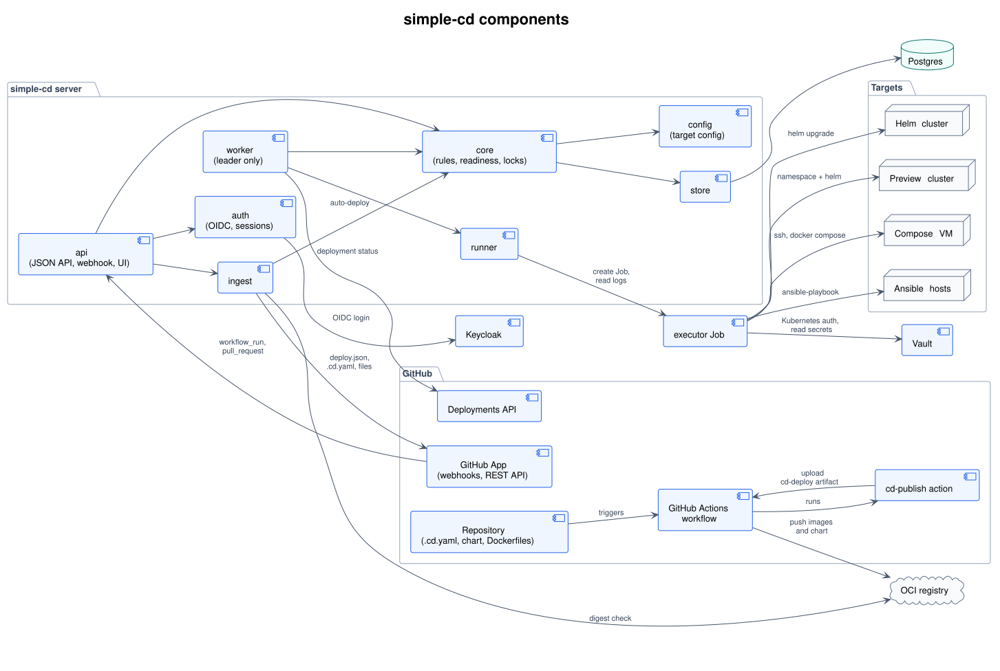
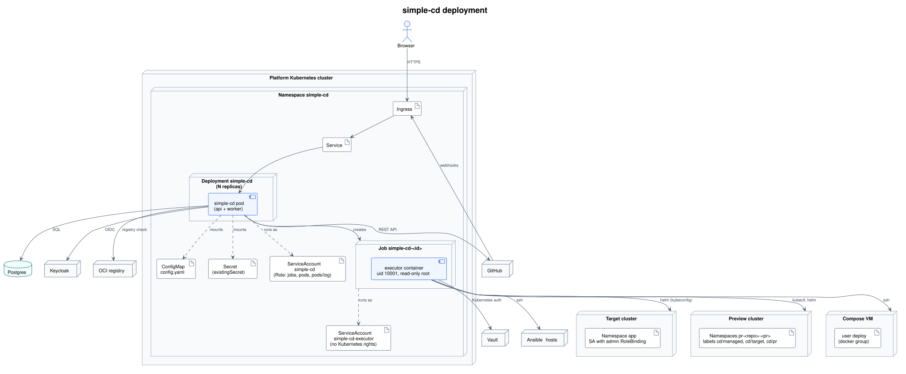

# Architecture
{: .no_toc }

This section describes simple-cd with UML diagrams.
The sources are PlantUML files in [`docs/architecture/diagrams`](https://github.com/Mtze/simple-cd/tree/main/docs/architecture/diagrams); `render.sh` turns them into the SVG files shown here.
The reasons behind the design are in the [design record](../design.md) (German).

1. TOC
{:toc}

## Principles

- **Delivery only.** simple-cd never builds or tests. Workflows publish finished artifacts; simple-cd ships them.
- **Stateless servers, state in Postgres.** Any replica serves any request; one elected replica does the background work.
- **Configuration in Git, state in the database.** The target configuration says what a target is; Postgres says what state it is in.
- **Provenance from GitHub.** Repository, commit, source and pull request come from the GitHub App, never from files the workflow writes.
- **Secrets never pass through the server.** Each deployment runs in its own Kubernetes Job that reads its secrets from Vault itself.
- **Few dependencies.** Kubernetes, Vault, GitHub and registries are reached over plain HTTP.

## Components



On the GitHub side, a workflow builds images and a chart, pushes them to an OCI registry and runs the `cd-publish` action, which uploads `deploy.json` as the workflow artifact `cd-deploy`.
The GitHub App delivers `workflow_run` and `pull_request` webhooks to the server's **api** component.

Inside the server:

- **api** serves the JSON API, the SSE log stream, the webhook endpoint and the embedded UI, and enforces CSRF protection and security headers.
- **auth** logs users in with Keycloak (OIDC with PKCE) and keeps sessions in Postgres.
- **ingest** turns webhooks into artifacts: it rejects forks, downloads `deploy.json`, reads `.cd.yaml` and the files it names at the commit, and checks the registry.
- **core** holds the domain rules: permissions, target status, readiness, locks, slots, maintenance, auto-deploy and previews.
- **worker** runs on the leader replica only: it starts pending deployments, watches Jobs, reports to the GitHub Deployments API, processes waiting auto-deploys, tears down expired previews and applies retention.
- **runner** creates executor Jobs and reads their logs through the Kubernetes API.
- **store** persists everything in Postgres; **config** holds the target configuration and reloads it.

The **executor Job** logs in to Vault with Kubernetes auth and deploys to the target: `helm` for Helm and preview clusters, `ssh` plus `docker compose` for Compose VMs, `ansible-playbook` for Ansible hosts.

## Deployment



simple-cd runs as a Kubernetes Deployment with N replicas behind a Service and an Ingress, in its own namespace.
Each pod mounts the target configuration from a ConfigMap and its own secrets from a Secret.
The pods run as the `simple-cd` service account, which may only manage Jobs and read pods and logs in that namespace.

For every deployment the server creates a Job `simple-cd-<id>` in the same namespace.
The Job runs as the `simple-cd-executor` service account, which has no Kubernetes permissions; its token only serves the Vault login.
Postgres, Keycloak and Vault run outside, as do the target clusters, the separate preview cluster, the Compose VMs and the Ansible hosts.
The executor reaches target clusters with a kubeconfig from Vault and VMs with an SSH key from Vault.

## More diagrams

| Page | Diagrams |
|---|---|
| [Data model](data-model.md) | UML class diagram of configuration, repository input and runtime state |
| [Flows](flows.md) | sequence diagrams of artifact ingestion and a manual deploy, activity diagram of the preview lifecycle |
| [State machines](states.md) | deployment status and target status |

## Editing diagrams

```sh
docs/architecture/diagrams/render.sh
```

The script renders every `*.puml` file with the pinned `plantuml/plantuml` Docker image.
All diagrams include `style.iuml` for a shared look.
Commit the `.puml` source and the `.svg` together.
