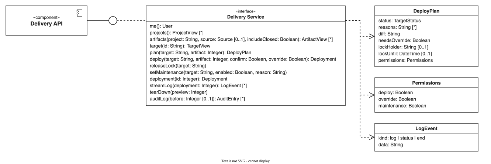
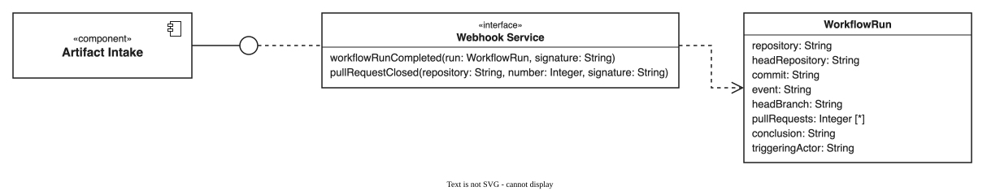
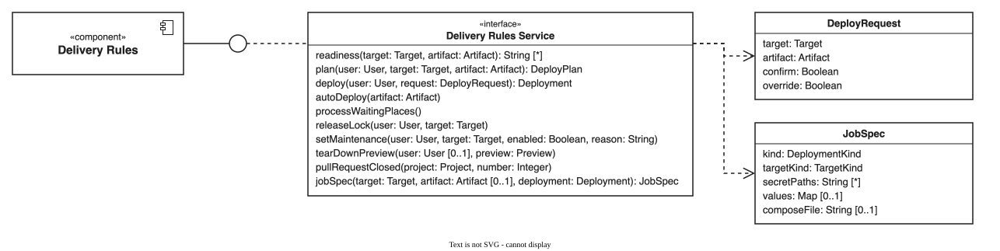

# Service specifications
{: .no_toc }

Detailed views of three services from the [component diagrams](index.md#components): the provider, the service as a UML interface with its operations, and the data types it uses.
Types like `Deployment`, `Target` and `Artifact` are the classes of the [object model](data-model.md).

1. TOC
{:toc}

## Delivery Service

Provided by the Delivery API, used by the simple-cd Console.
Over the wire it is the JSON API described in the [HTTP API reference](../reference/api.md); `streamLog` is the Server-Sent Events stream.

## Webhook Service

Provided by the Artifact Intake, called by GitHub.
Every call carries an HMAC-SHA256 signature; runs from forks and from repositories that are not projects are dropped.

## Delivery Rules Service

Provided by the Delivery Rules inside the server, used by the Delivery API, the Artifact Intake and the Deployment Scheduler.
It is the only place that decides whether a deployment may start, and it builds the job specification the executor receives.

