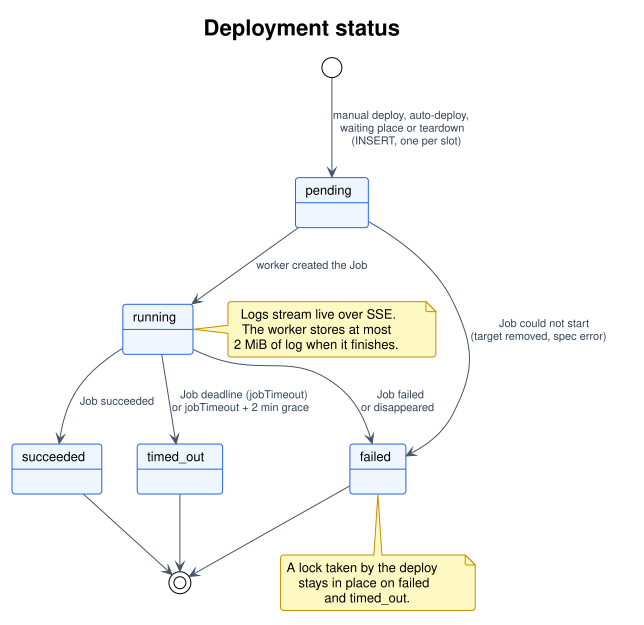
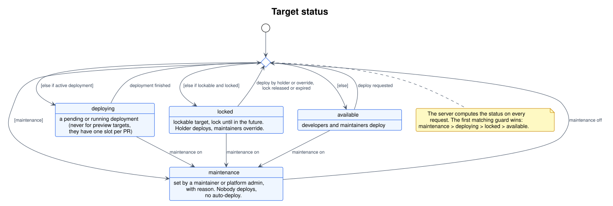

# State machines

## Deployment status

Every deployment starts as `pending`: a manual deploy, an auto-deploy, a waiting auto-deploy whose slot became free, or a preview teardown inserts the row.
The unique index on target and slot allows only one pending or running deployment per slot.
The worker moves it to `running` once the executor Job exists.
If the Job cannot start, for example because the target was removed from the configuration, it ends as `failed` right away.
A running deployment ends as `succeeded` or `failed` from the Job's result, as `failed` when the Job disappears, and as `timed_out` when Kubernetes kills it at `jobTimeout` or the worker gives up two minutes later.
The three end states are final; a lock taken by the deploy stays in place in all of them.

## Target status

The target status is not stored; the server computes it on every request from the target state row, the active deployments and the clock.
The choice point checks the guards in order, and the first match wins: `maintenance` before `deploying` before `locked` before `available`.
Starting a deploy, a deployment finishing, a lock being released or expiring, and switching maintenance all lead back to the choice point.
Switching maintenance on wins over every other state.
Preview targets never become `deploying` as a whole, because every pull request has its own slot, and never become `locked`, because they cannot be lockable.
