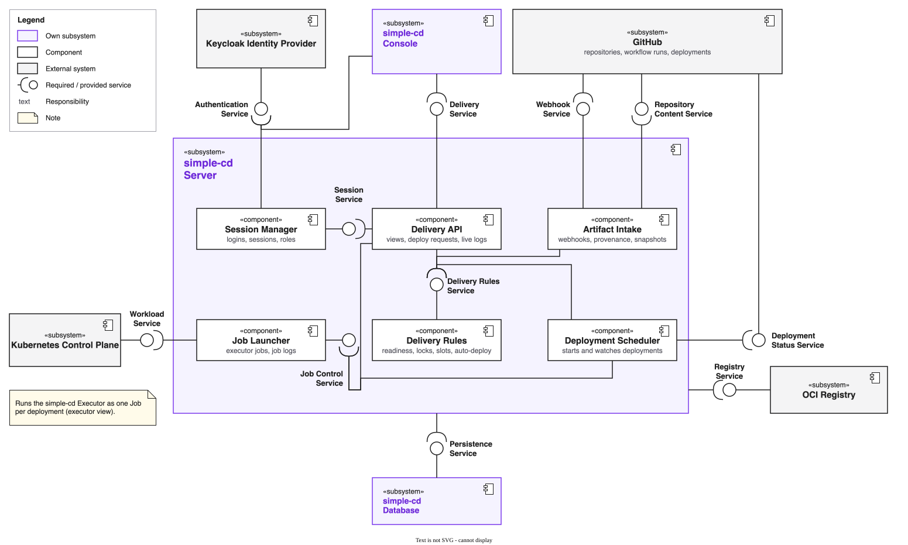

# simple-cd

simple-cd is a small continuous delivery server.
It builds nothing and runs no tests: your GitHub Actions workflow does that.
simple-cd only delivers.
It sees the artifacts your workflows publish, checks that they are complete, and lets authorized people deploy them to a target with one click.

## Features

- **Three target types:** Helm releases on Kubernetes (chart from an OCI registry), a single Docker Compose file on a VM, and Ansible playbooks.
- **Digest pinning:** every image is referenced by its `sha256` digest, so exactly the built image runs.
- **Readiness checks:** each artifact shows, per target, whether it is deployable and why not.
- **Configuration diff:** before a deploy, the UI shows what changed in the Helm values or the Compose file since the last deploy and asks for confirmation.
- **Locks:** opt-in per target, so a tester can keep a test system for an hour without someone else deploying over it.
- **Maintenance mode:** blocks every deploy on a target, auto-deploys included.
- **Previews:** one Kubernetes namespace per pull request, with a TTL, torn down when the PR closes.
- **Auto-deploy:** a workflow asks for it, the target allows it with a rule.
- **Live logs:** executor output streams to the browser while the deploy runs.
- **GitHub integration:** deployments appear on the commit and in the pull request timeline.
- **Roles from Keycloak:** per project developer and maintainer roles, an optional extra role per target and a platform admin role.
- **Secrets stay in Vault:** the executor Job reads them itself, they never pass through the server or etcd.
- **Audit log:** every deploy, lock, maintenance switch and login.

## How it fits together

1. Your workflow builds images and a chart and pushes them to a registry.
2. The [`cd-publish` action](reference/deploy-json.md) writes `deploy.json` (image digests, chart version) and uploads it as the workflow artifact `cd-deploy`.
3. When the run finishes, GitHub sends a `workflow_run` webhook to the simple-cd **GitHub App**.
4. simple-cd downloads `deploy.json`, reads [`.cd.yaml`](reference/cd-yaml.md) at the same commit, checks the registry and stores the artifact.
5. A user clicks Deploy, or an auto-deploy rule fires.
6. simple-cd starts an **executor** as a Kubernetes Job, which logs in to Vault and runs `helm`, `docker compose` over SSH, or `ansible-playbook` against the **target**.

## Where to start

| You are | You want to | Read |
|---|---|---|
| Developer | onboard a repository and deploy | [Users](users/index.md) |
| Project maintainer | handle locks, maintenance and previews | [Maintainers](maintainers/index.md) |
| Platform operator | install and run simple-cd | [Administrators](admin/index.md) |
| Contributor | change simple-cd itself | [Contributors](contributors/index.md) |
| Anyone | look up a file format, an endpoint or a setting | [Reference](reference/index.md) |
| Anyone | understand the design | [Architecture](architecture/index.md) |

## Terminology

| Term | Meaning |
|---|---|
| Project | One GitHub repository (`owner/repo`). It may build several images. |
| Target | A place to deploy to: a Helm release, a Compose VM or an Ansible inventory. Each target belongs to one project and has a stable `id`. |
| Artifact | What one commit published: `deploy.json` plus the `.cd.yaml` snapshot at that commit. |
| Deployment | One run of the executor for one artifact on one target. A teardown of a preview is a deployment too. |
| Slot | Where at most one deployment runs at a time: the target, or for preview targets the pair of target and pull request. |
| Lock | A time-limited claim on a lockable target by the person who deployed. |
| Maintenance | A manual block on a target. Nobody deploys while it is on. |
| Preview | A Helm deployment of a pull request into its own namespace. |
| Auto-deploy | A deployment started by GitHub instead of a person. |
| Executor | The program that runs one deployment inside a Kubernetes Job. |
| Platform admin | The role that may do everything in every project. |
| Developer, maintainer | The two project roles. |

simple-cd is open source under the MIT License: [github.com/Mtze/simple-cd](https://github.com/Mtze/simple-cd).
